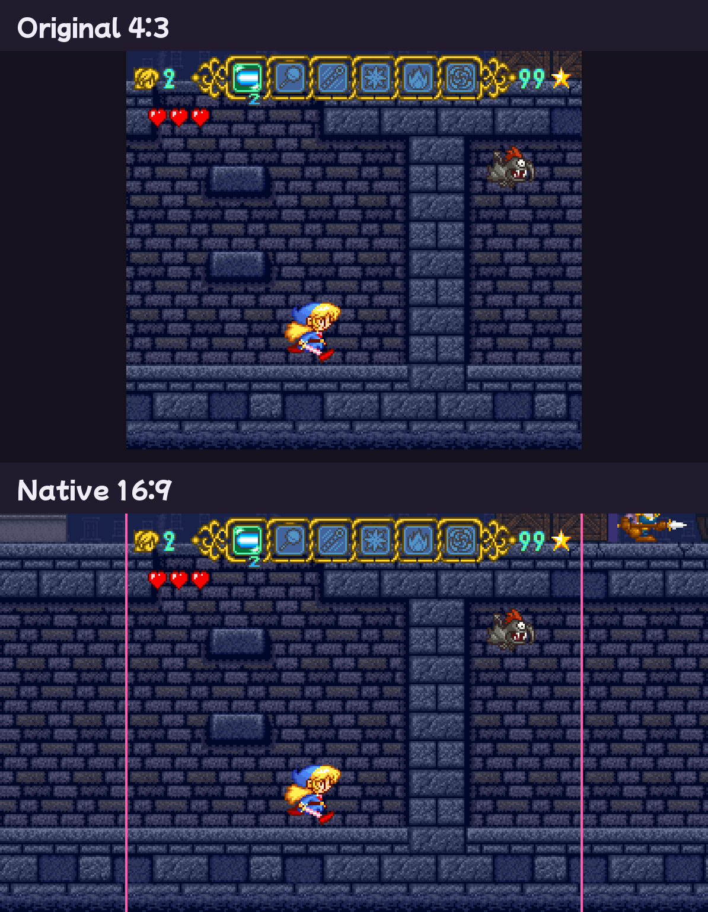
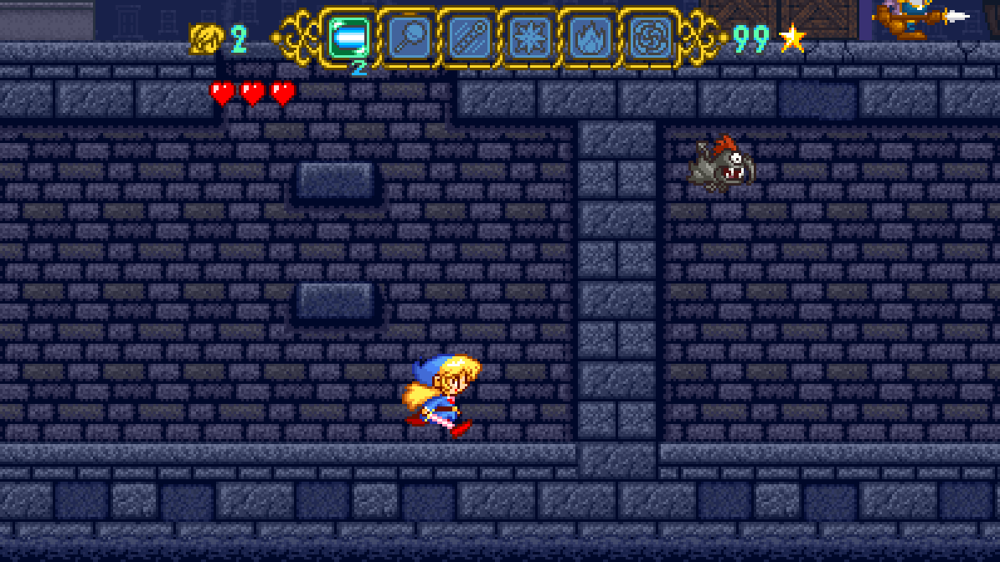

<h1 align="center">Magical Pop'n Recomp</h1>

  
  
  

A **static recompilation** of the SNES game *Magical Pop'n* (Pack-In-Video / Polestar, 1995).
The game's 65816 code is translated into C ahead of time and compiled into a native Windows
program, with a small menu for window size, fullscreen, smoothing, FPS, volume, controls and language.

**This repository contains no game code, graphics data or ROM contents.** You need your own copy of the game as a ROM file.
The builder reads it on your PC and produces `MagicalPopn.exe`.

**This is version 0.9.3, so there is a slight chance of bugs.**

## Native 16:9 widescreen

Levels are rendered wider rather than stretched, so the pixels keep their shape and the extra columns on each side show the real level and its enemies.

16:9 mode is still undergoing active testing and there might be a few visual glitches. 4:3 is the best experience for now, but 16:9 is almost perfect.

## Known issues

These are tracked on the [Issues](https://github.com/looking-glassinsects/MagicalPopnRecomp/issues) tab, where you can add details or screenshots.

| # | Issue | Area |
|---|---|---|
| [1](https://github.com/looking-glassinsects/MagicalPopnRecomp/issues/1) | Boss head only bounces inside the 4:3 area in 16:9 | 16:9 |
| [2](https://github.com/looking-glassinsects/MagicalPopnRecomp/issues/2) | Boomerangs get stuck on the screen | 16:9 |
| [3](https://github.com/looking-glassinsects/MagicalPopnRecomp/issues/3) | Some rooms show broken graphics in the 16:9 side columns | 16:9 |
| [4](https://github.com/looking-glassinsects/MagicalPopnRecomp/issues/4) | Throne room before the final boss is broken in 16:9 | 16:9 |
| [6](https://github.com/looking-glassinsects/MagicalPopnRecomp/issues/6) | Side columns change while going through the tubes | 16:9 |
| [7](https://github.com/looking-glassinsects/MagicalPopnRecomp/issues/7) | Mace ghosts and clones its sprite | Motion smoothing |
| [8](https://github.com/looking-glassinsects/MagicalPopnRecomp/issues/8) | Sprite flickers on the spring in the first area | Graphics |
| [9](https://github.com/looking-glassinsects/MagicalPopnRecomp/issues/9) | Bottom of open doors shimmers when walking past | Graphics |
| [10](https://github.com/looking-glassinsects/MagicalPopnRecomp/issues/10) | Frame drops in some rooms and when lots is on screen | Performance |
## Quick start

1. Download **`MagicalPopn-Builder.zip`** from the [latest release](https://github.com/looking-glassinsects/MagicalPopnRecomp/releases/latest) and extract it anywhere.
2. Drag your ROM onto **`Builder.exe`** (or onto the builder window).
3. Wait about a minute and a half while it builds, then press **Play**.

That's all: nothing to install. You need Windows 10 or 11 (64-bit) and a Magical Pop'n ROM.
Any dump works: `.sfc`, `.smc` or `.zip`, with or without a copier header, the original
Japanese release or a translated/patched version. The game is placed in a `MagicalPopn`
folder next to the builder, and you can move that folder anywhere.

The download includes its own C compiler ([llvm-mingw](https://github.com/mstorsjo/llvm-mingw),
clang + lld, trimmed to 64-bit Windows) in the `toolchain` folder, so the builder never needs
Visual Studio or Python.

### Building from the source instead

With Python 3 and either a `toolchain` folder holding llvm-mingw in the repository root or the
Microsoft C++ Build Tools, run `Builder.bat` or
`python tools/pipeline.py ROM [--out DIR]`. To package the builder yourself, run
`python -m PyInstaller builder/Builder.spec`.

The whole game is compiled before it starts. There's nothing to configure:
- The repository ships a **code map** (`data/codemap.txt`): the addresses of every routine
  found by many hours of automated play, plus a checksum of the code bytes at each one, and
  no game data. Every entry whose code matches your ROM is used. The map covers the original
  Japanese release, the FastROM v1.1 patch (Japanese and English) and the English translation
  patch, so all of these build straight away.
- Static analysis adds everything reachable from those routines, including routines
  referenced through pointer tables in the code.
- After compiling, the builder test-plays the finished game and recompiles once more if that
  test found anything new.

As a safety net, any code the build still missed runs through a built-in interpreter instead
of stopping, and building again includes it.

## Playing

| Keyboard | SNES | Xbox | PlayStation | Switch |
|---|---|---|---|---|
| Arrow keys | D-pad | D-pad / left stick | D-pad / left stick | D-pad / left stick |
| Z / X | B / A | A / B | Cross / Circle | B / A |
| A / S | Y / X | X / Y | Square / Triangle | Y / X |
| Q / W | L / R | LB / RB | L1 / R1 | L / R |
| Enter / Right Shift | Start / Select | Start / Back | Options / Share | + / − |

| Key | |
|---|---|
| **F1** or **Esc** | menu (on a controller: click a stick, press Home / PS, or hold Select + Start) |
| **F5** / **F9** | save state / load state (current slot) |
| **F6** / **F7** | previous / next save slot (9 slots) |
| **P** | pause |
| **F11** or **Alt+Enter** | fullscreen |
| **F12** | screenshot (saved to `screenshots\`) |
| **Tab** (hold) / right trigger | fast-forward |

**Controllers.** Plug in or pair any controller, before or during play, and it works straight
away. You can use several at once. Buttons go by position, as on a Super Famicom pad: bottom = B,
right = A, left = Y, top = X. The game reads:
- **Xbox-style controllers (XInput):** all four slots. This also covers most modern third-party
  pads, 8BitDo pads in X mode, Steam Input and DS4Windows.
- **Every other controller:** read directly through Windows (HID), so any USB or Bluetooth
  gamepad or joystick gives its buttons, sticks and d-pad.
- **Built-in layouts:**
  - DualShock 4 and DualSense, over USB and Bluetooth.
  - Switch Pro Controller and the Nintendo Switch Online SNES controller, which the game wakes up
    and switches to their full report.
  - 8BitDo pads in D-input mode, common USB SNES-style pads, and the usual PC gamepad layout.

If a controller's buttons end up in the wrong places, open **Set up controller** on the **Controls** page of the F1 menu
and press each button when asked. Esc skips a button and Backspace stops. The layout is saved for
that kind of controller (`[pad VVVV-PPPP]` in `settings.ini`). **Reset to defaults** puts every
controller back to its built-in layout.

The **F1 menu**, styled after the Super Famicom cover art, is a single list on a pink panel, with the selected row highlighted. Use Up and Down to
pick a row, Left and Right to change it, and Enter to activate. Esc goes back, and closes the menu from the
main page. The mouse works too: hover to select, left-click to change or activate, right-click
to change the other way. A note under the list explains the selected setting, and settings are
saved automatically.
- **Main:** resume, save/load state, save slot, continue on launch, language (English / 日本語),
  screenshot, reset (press twice), quit (press twice), and three sub-pages:
- **Video:** window size, display mode, **VSync**, **low latency**, **motion smoothing** (60 / 120 fps), **widescreen** (off / 16:9 / 16:10 / 21:9),
  pixel shape (square / TV 8:7 / stretch), integer scaling, smoothing, scanlines, **sprite limit**, FPS counter
- **Sound:** volume, mute, mute in background, pause in background
- **Controls:** the controller in use, controller setup, rebind every key, fast-forward speed, reset to defaults

**Sprite limit** is off by default. The SNES can only draw so many sprites on one line (32 sprites
or 34 eight-pixel slices), and anything past that is cut off. The game hits the limit in a few busy
moments, such as the heroine running past the dust cloud on the title screen. With the setting off,
every sprite is drawn. Turn it on for the original look. Only the picture changes: the game still
sees the hardware's overflow flags as before, so it plays the same.

**Continue on launch** (off by default) saves your exact place when you quit and resumes it the
next time you start. Settings are saved in `settings.ini` next to the game, and save states
in `states\`.

### Smoothness and latency

- **Motion smoothing** (off by default; set it to **120** under Video, for screens faster than 75 Hz):
  the game still runs at its native 60 fps, and an in-between picture is drawn after every game
  frame. On a 240 Hz monitor each picture stays up for exactly two refreshes, on a 120 Hz one
  for one. A 144 Hz monitor can't divide 120 evenly, so it gets a new picture on 5 refreshes out of
  every 6. A display thread redraws the frame with the console's own
  graphics chip, with each layer's scroll position and every sprite placed where they are at
  that exact moment between the last two frames. Pixel art stays crisp: nothing is blended or
  smeared. Pictures are timed by a clock locked to the monitor's real refresh signal, so each
  one stays on screen for exactly the same number of refreshes (two each at 120 fps on a
  240 Hz screen). Each picture is drawn a few milliseconds before its refresh and presented
  just after it, so a slow moment in the graphics driver doesn't make it miss its refresh. It
  uses VSync and adds about 1.5 frames (~25 ms) of delay. Set it to 60 under Video for the
  lowest latency.
- **With motion smoothing at 60** (or on a 60 Hz screen), each game frame is shown as it is. On
  a 120 Hz or 240 Hz monitor each frame stays for exactly 2 or 4 refreshes, so motion stays
  perfectly even, and the wait for the next refresh shrinks to about 8 ms or 4 ms. Other
  refresh rates (such as 144 Hz) use timer pacing.
- **Low latency** (applies with motion smoothing at 60): the frame is shown the moment the console finishes drawing it. Controller
  input is then read as late as possible, just before the game's own read, about 3 ms before
  the next frame is due. Together this removes more than a frame of delay compared with
  ordinary emulation.
- **Audio** runs on its own WASAPI thread. Gentle rate control (at most ±1% pitch,
  inaudible) keeps about 20 ms of sound buffered, so it never crackles or drifts.

### Widescreen

Widescreen (off by default; choose it under Video) is **rendered natively, not stretched**: the game shows more of
the level at both sides. Magical Pop'n only keeps one screen-and-a-bit of the level in video
memory, but it holds a much wider strip of the decoded level map in WRAM. Each frame, the
renderer finds where the visible picture sits in that map and draws the extra columns from it,
so they show the real level.
- The status bar stays centred.
- Screens that don't scroll (logos, title, story scenes, menus) are pillarboxed in black, since
  they were only ever drawn 256 pixels wide.
- Each area is wide from its very first frame, and nothing is drawn beyond the area's own edges.
- Enemies, items and effects are drawn in the extra columns too: the game's sprite-drawing
  helpers are patched (found by code signature, so this works for any version of the game) to
  cull against the wide screen instead of the 4:3 one. Enemies stay active from 128 px left of
  the original screen to 112 px right of it, which covers 16:9 and 16:10. At 21:9 they can
  still appear a few pixels inside the far right edge.

The game's own text comes from the ROM you build from, so a translated ROM gives an English game.

## How it works

1. A trace profiler (emulator and input bot) plays your ROM and records code entry points with their register widths.
2. A 65816 tracer with pointer harvesting finds every routine from those entries.
3. A C emitter turns the routines into about 2 million lines of C.
4. The bundled clang (or MSVC) compiles them into `MagicalPopn.exe`, with the ROM embedded as a resource.

| Path | |
|---|---|
| `builder/builder.pyw` | the builder window |
| `tools/toolchain.py` | bundled clang or MSVC: compile, resources, link |
| `tools/pipeline.py` | build steps; also usable from the command line: `python tools/pipeline.py ROM [--out DIR] [--force]` |
| `tools/snes.py` | reads any dump format and identifies the game |
| `tools/disasm65816.py` | recursive-descent tracer that tracks the M/X register-width flags; pointer and pointer-table harvesting |
| `data/codemap.txt` | shipped code entry points (addresses + code checksums, no game data); regenerate with `tools/make_codemap.py` |
| `tools/emit_c.py` | turns each routine into C with fixed register widths |
| `runtime/trace_main.c` | build-time profiler: plays the game with a bot and records code entry points |
| `runtime/rt.*` | 65816 semantics, call/return handling (unwinds games' stack tricks), interpreter fallback, save-state capture |
| `runtime/hw.c` | SNES hardware (PPU, SPC700 + DSP, DMA) via LakeSnes, the widescreen level-map source, and motion smoothing (per-line PPU records, in-between pictures) |
| `runtime/platform_win32.c`, `audio_wasapi.c`, `menu.c`, `settings.c` | OpenGL window with vsync (and the motion-smoothing display thread), WASAPI audio, input, F1 menu, settings |

Nothing is tied to one particular dump. Every address the game uses is found by analysing the
ROM you provide.

## Credits

- Contributor: [Claude](https://claude.com/claude-code) by Anthropic, on the recompiler, runtime and builder.
- Hardware emulation: [LakeSnes](https://github.com/angelo-wf/LakeSnes) by angelo_wf, MIT licence
  (`third_party/LakeSnes/LICENSE.txt`). Only its `snes/` core is included; its PPU is extended
  for widescreen rendering and motion smoothing (changes marked `[widescreen]` and `[recomp]`).
- Icon and README picture: the heroine's sprite from *Magical Pop'n* (`assets/`, rebuilt by `tools/make_icon.py`).
- Menu font: [Mochiy Pop P One](https://fonts.google.com/specimen/Mochiy+Pop+P+One) by Fontworks, SIL Open Font License (`runtime/fonts/OFL.txt`); `tools/subset_font.py` cuts it down to the menu's characters.
- Compiler in the release download: [llvm-mingw](https://github.com/mstorsjo/llvm-mingw) by Martin Storsjö (LLVM, Apache 2.0 with LLVM exception; mingw-w64 runtime, see `toolchain/LICENSE.TXT`).
- *Magical Pop'n* © 1995 Pack-In-Video / Polestar. This project is not affiliated with them and
  includes none of their data apart from the heroine's sprite used as the icon and the crop of the cover art in the builder window.
